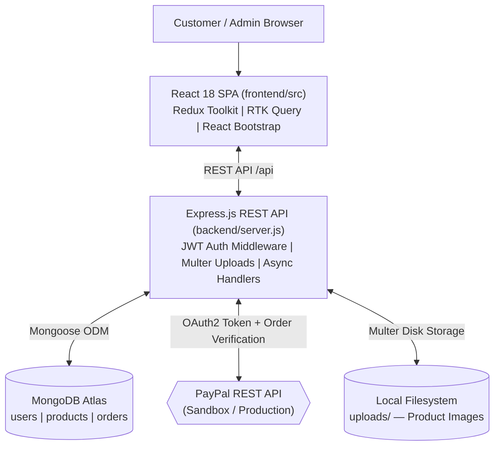
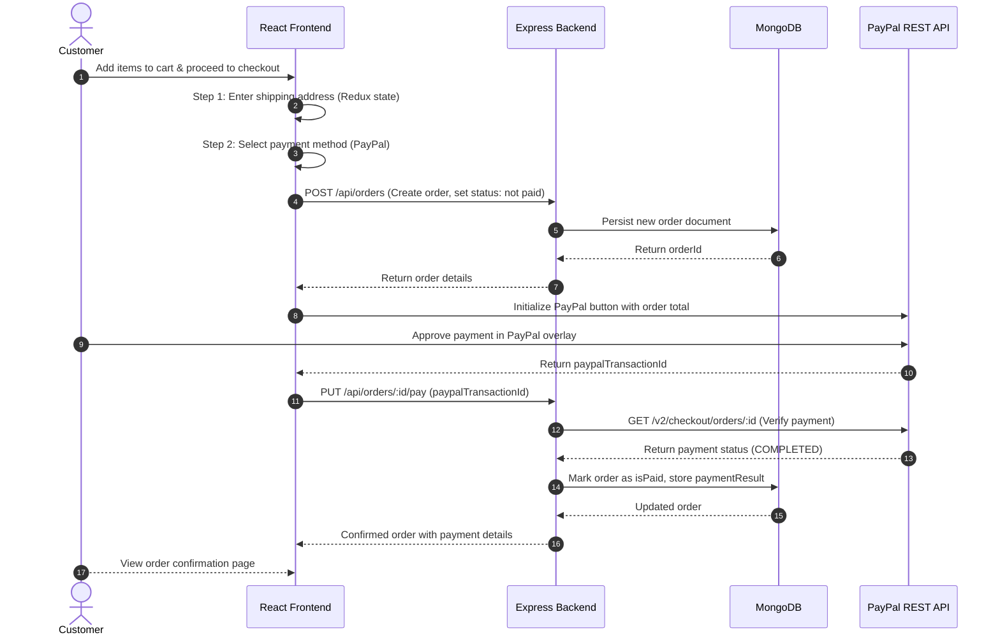

# ProShop – E-Commerce Platform

> Full-featured MERN stack e-commerce platform with shopping cart, PayPal payment integration, JWT authentication, product image uploads, and a full admin dashboard for managing products, orders, and users.

[](https://nodejs.org/)
[](https://expressjs.com/)
[](https://www.mongodb.com/)
[](https://react.dev/)
[](https://redux-toolkit.js.org/)
[](https://getbootstrap.com/)
[](https://developer.paypal.com/)
[](LICENSE)

---

## Table of Contents

- [Overview](#overview)
- [System Architecture](#system-architecture)
- [Key Features](#key-features)
- [Checkout & Payment Flow](#checkout--payment-flow)
- [Tech Stack](#tech-stack)
- [Project Structure](#project-structure)
- [Getting Started](#getting-started)
  - [Prerequisites](#prerequisites)
  - [Installation](#installation)
  - [Environment Variables Setup](#environment-variables-setup)
  - [Run the Application](#run-the-application)
- [API Endpoints](#api-endpoints)
- [Admin Dashboard](#admin-dashboard)
- [Database Seeder](#database-seeder)
- [Screenshots & Visuals](#screenshots--visuals)
- [Roadmap](#roadmap)
- [Credits & Based On](#credits--based-on)
- [Author](#author)
- [License](#license)

---

## Overview

ProShop is a complete, production-structured e-commerce application demonstrating the MERN stack (MongoDB, Express, React, Node.js). It covers both the customer-facing shopping experience — from browsing and cart management through multi-step checkout and PayPal payment — and a full admin control plane for managing the product catalog, customer accounts, and order fulfillment.

The backend is implemented as an Express REST API using ES Modules, with JWT authentication stored in HTTP-only cookies for XSS resistance. The frontend is a React 18 single-page application using Redux Toolkit for global state and RTK Query for typed data fetching.

---

## System Architecture



---

## Key Features

- **Product Catalog**: Paginated product listing with keyword search, top-rated product carousel, and per-product review and rating system.
- **Shopping Cart**: Persistent cart state managed by Redux Toolkit with real-time price and quantity calculations.
- **Multi-Step Checkout**: Sequential checkout flow — Shipping Address → Payment Method → Place Order → Payment Confirmation.
- **PayPal Integration**: Full PayPal REST API integration via `@paypal/react-paypal-js`. Includes live PayPal order creation, payment capture verification, and new-transaction deduplication.
- **JWT Authentication**: Stateless bearer tokens generated on login and stored in HTTP-only cookies for XSS resistance.
- **User Profiles**: Customers can view and update personal details, and browse their complete order history.
- **Product Image Uploads**: Admin-side image uploads handled server-side by Multer and served as static files from `uploads/`.

---

## Checkout & Payment Flow



---

## Tech Stack

| Layer | Technology | Description |
|---|---|---|
| **Runtime** | Node.js (v18+, ES Modules) | Backend JavaScript runtime with native `import/export` |
| **Web Framework** | Express.js 4.x | REST API routing, error handling, and middleware |
| **Database** | MongoDB Atlas + Mongoose 8.x | Document-oriented database with schema validation and ODM |
| **Frontend** | React 18 + Vite (or CRA) | SPA with hooks, React Router v6 navigation |
| **State & Data** | Redux Toolkit + RTK Query | Global cart/auth state and server-state caching |
| **Styling** | Bootstrap 5 + React Bootstrap | Responsive grid layout and pre-built UI components |
| **Authentication** | `jsonwebtoken` + HTTP-only Cookie | Stateless JWT bearer auth with cookie transport |
| **Payments** | PayPal REST API + `@paypal/react-paypal-js` | Live order creation and server-side payment verification |
| **File Uploads** | Multer | Multipart form handling and local disk storage for images |
| **Password Security** | `bcryptjs` | Salted hash generation and timing-safe comparison |

---

## Project Structure

```text
proshop/
├── backend/
│   ├── config/
│   │   └── db.js                  # MongoDB Atlas Mongoose connection
│   ├── controllers/
│   │   ├── orderController.js     # Order CRUD, payment capture, delivery status
│   │   ├── productController.js   # Product CRUD, image upload, top-products, reviews
│   │   └── userController.js      # Register, login, profile, admin user management
│   ├── data/
│   │   ├── products.js            # Seed product data
│   │   └── users.js               # Seed user data (admin + customers)
│   ├── middleware/
│   │   ├── authMiddleware.js      # JWT verification and admin-role guard
│   │   ├── asyncHandler.js        # Express async error wrapper
│   │   ├── checkObjectId.js       # MongoDB ObjectId validation middleware
│   │   └── errorMiddleware.js     # Global error handler (dev: stack, prod: message)
│   ├── models/
│   │   ├── orderModel.js          # Order schema (line items, payment, shipping)
│   │   ├── productModel.js        # Product schema (reviews sub-document array)
│   │   └── userModel.js           # User schema with bcrypt pre-save hook
│   ├── routes/
│   │   ├── orderRoutes.js         # Order CRUD and delivery + payment endpoints
│   │   ├── productRoutes.js       # Product list, detail, create, update, review
│   │   ├── uploadRoutes.js        # Image upload endpoint (Multer)
│   │   └── userRoutes.js          # Auth, profile, admin user management
│   ├── utils/
│   │   ├── calcPrices.js          # Tax and order total calculations
│   │   ├── generateToken.js       # JWT signing utility
│   │   └── paypal.js              # PayPal OAuth token fetch and payment verification
│   └── server.js                  # Express app entry, routes mount, static file serving
├── frontend/
│   ├── src/
│   │   ├── components/            # Reusable UI: Header, Footer, Paginate, Rating
│   │   ├── screens/               # Customer: Home, Product, Cart, Checkout, Profile, Order
│   │   ├── screens/admin/         # Admin: ProductList, ProductEdit, UserList, UserEdit, OrderList
│   │   ├── slices/                # Redux Toolkit: authSlice, cartSlice, and RTK Query API slices
│   │   └── utils/                 # Shared cart utilities
│   └── package.json
├── uploads/                       # Product images stored by Multer (gitignored content)
├── .env.example                   # Environment variables template
├── .gitignore
├── package.json                   # Root: concurrently runs backend + frontend
└── LICENSE
```

---

## Getting Started

### Prerequisites

- [Node.js (v18+)](https://nodejs.org/) installed.
- A free [MongoDB Atlas](https://www.mongodb.com/atlas) account with a database and connection URI.
- A [PayPal Developer](https://developer.paypal.com/) account with a sandbox application for `Client ID` and `App Secret`.
- Git installed.

---

### Installation

1. Clone the repository:
   ```bash
   git clone https://github.com/Rohit-hub-coder/proshop.git
   cd proshop
   ```

2. Install all dependencies (root + frontend):
   ```bash
   npm install
   cd frontend && npm install && cd ..
   ```

---

### Environment Variables Setup

Create a `.env` file at the project root using the provided template:

```powershell
# Windows PowerShell
Copy-Item .env.example .env
```

Fill in your values in `.env`:

```env
NODE_ENV=development
PORT=5000
MONGO_URI=mongodb+srv://<username>:<password>@cluster.mongodb.net/proshop
JWT_SECRET=your_strong_random_secret
PAYPAL_CLIENT_ID=your_paypal_sandbox_client_id
PAYPAL_APP_SECRET=your_paypal_sandbox_app_secret
PAYPAL_API_URL=https://api-m.sandbox.paypal.com
PAGINATION_LIMIT=8
```

---

### Run the Application

```bash
# Start both backend (:5000) and frontend (:3000) concurrently
npm run dev

# Backend only
npm run server

# Frontend only
npm run client
```

Open [http://localhost:3000](http://localhost:3000) to use the app.

---

## API Endpoints

All routes served from the Express backend at `http://localhost:5000`.

| Method | Route | Auth | Admin | Description |
|---|---|:---:|:---:|---|
| `POST` | `/api/users` | No | — | Register a new customer account |
| `POST` | `/api/users/auth` | No | — | Authenticate user, return JWT cookie |
| `POST` | `/api/users/logout` | Yes | — | Clear JWT cookie (logout) |
| `GET` | `/api/users/profile` | Yes | — | Get logged-in user's profile |
| `PUT` | `/api/users/profile` | Yes | — | Update name, email, or password |
| `GET` | `/api/users` | Yes | ✅ | Admin: list all users |
| `GET` | `/api/users/:id` | Yes | ✅ | Admin: get user by ID |
| `PUT` | `/api/users/:id` | Yes | ✅ | Admin: update user record or role |
| `DELETE` | `/api/users/:id` | Yes | ✅ | Admin: delete user |
| `GET` | `/api/products` | No | — | Paginated product list with keyword search |
| `GET` | `/api/products/top` | No | — | Top-rated products for homepage carousel |
| `GET` | `/api/products/:id` | No | — | Get product details and reviews |
| `POST` | `/api/products` | Yes | ✅ | Admin: create empty product |
| `PUT` | `/api/products/:id` | Yes | ✅ | Admin: update product details |
| `DELETE` | `/api/products/:id` | Yes | ✅ | Admin: delete product |
| `POST` | `/api/products/:id/reviews` | Yes | — | Submit a product review and rating |
| `POST` | `/api/upload` | Yes | ✅ | Admin: upload product image via Multer |
| `POST` | `/api/orders` | Yes | — | Place a new order |
| `GET` | `/api/orders/mine` | Yes | — | Get all orders for the logged-in user |
| `GET` | `/api/orders/:id` | Yes | — | Get specific order details (owner verified) |
| `PUT` | `/api/orders/:id/pay` | Yes | — | Capture PayPal payment and mark as paid |
| `GET` | `/api/orders` | Yes | ✅ | Admin: list all customer orders |
| `PUT` | `/api/orders/:id/deliver` | Yes | ✅ | Admin: mark order as delivered |

---

## Admin Dashboard

The admin panel (`/admin`) provides:
- **Product Management**: Full CRUD on product catalog including image upload, pricing, inventory count, and category management.
- **User Management**: List all registered customers, view profiles, edit role flags (is admin), and delete accounts.
- **Order Management**: View all orders, inspect line items, update delivery status.

Access requires a user account with `isAdmin: true`. The database seeder creates one by default (see below).

---

## Database Seeder

The seeder script populates (or destroys) sample product and user data:

```bash
# Import sample data
npm run data:import

# Destroy all data
npm run data:destroy
```

**Default seeded accounts** (for local dev only):

| Email | Password | Role |
|---|---|---|
| `admin@email.com` | `123456` | Admin |
| `john@email.com` | `123456` | Customer |
| `jane@email.com` | `123456` | Customer |

---

## Screenshots & Visuals

*Place preview assets under `docs/`:*

- `docs/home-screen.png`: Product listing with carousel and search.
- `docs/product-detail.png`: Product page with reviews and rating.
- `docs/checkout-flow.png`: Multi-step checkout flow.
- `docs/paypal-payment.png`: PayPal sandbox payment overlay.
- `docs/admin-dashboard.png`: Admin order and product management dashboard.

---

## Roadmap

- [ ] **Stripe Payment Gateway**: Add Stripe as an alternative payment method.
- [ ] **Order Email Notifications**: Send confirmation emails via Nodemailer on order creation and delivery.
- [ ] **Product Inventory Alerts**: Admin notification when stock falls below a threshold.
- [ ] **Wishlist Feature**: Allow logged-in customers to save products for later.
- [ ] **Deployment to Railway / Render**: Full production deployment guide.

---

## Credits & Based On

This project was built by **Rohit Kumar** following the curriculum and initial project structure from the **[MERN Stack From Scratch | eCommerce Platform](https://www.udemy.com/course/mern-ecommerce/)** course by **Brad Traversy** (Traversy Media). The original course template is MIT-licensed.

Significant additions and modifications made during development include:
- Extended PayPal integration with server-side `verifyPayPalPayment` and `checkIfNewTransaction` deduplication logic.
- Restructured backend to ES Module `import/export` syntax throughout.
- Extended admin dashboard with `UserEditScreen` and `UserListScreen`.
- Hardened error middleware, `asyncHandler`, and `checkObjectId` middleware.

---

## Author

**Rohit Kumar**  
Software Engineering Undergrad @ Delhi Technological University (DTU)  
- GitHub: [@Rohit-hub-coder](https://github.com/Rohit-hub-coder)  
- LinkedIn: [Rohit Kumar](https://linkedin.com/in/rohit-kumar-dtu)  
- Email: [dhimanrohit1003@gmail.com](mailto:dhimanrohit1003@gmail.com)

---

## License

This project is licensed under the [MIT License](LICENSE).
